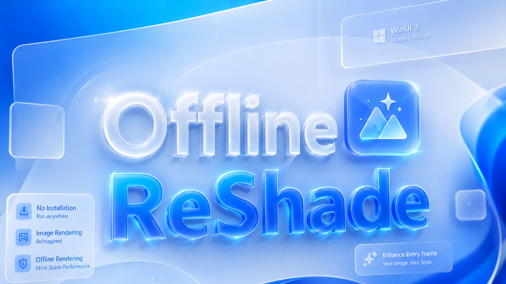

[中文说明](README.zh-CN.md) | English

# Offline ReShade

Version 0.8.3 establishes a checked upstream/dependency/interface baseline,
version handshakes, verified CI packaging and MCP diagnostics. Existing synchronized
GPU previews, DPI/zoom fixes, export validation and content-based batch resume remain.
Preview zoom/fallback does not change final pixels; intentional black images remain valid.
See [CHANGELOG](CHANGELOG.md), [MCP setup and tools](docs/MCP.md),
[maintenance and upgrades](docs/MAINTENANCE.md), and the [stability plan](docs/STABILITY_PLAN.md).

The portable release includes both .NET and Windows App SDK runtime dependencies.
User settings are saved in `%LOCALAPPDATA%\OfflineReShade\settings.json`; existing
`OfflineReShadeWinUI.settings.json` files beside the executable are imported when
the new settings file does not exist.

<p align="center">
  
</p>

Offline ReShade is a Windows tool for applying ReShade FX effects to still
images or exported frame sequences. It is designed for Koikatu (KK) and
Koikatsu Sunshine (KKS) offline capture workflows:

- the game-side plugins export color and depth files;
- `OfflineReShadeWinUI.exe` provides the editing UI;
- `OfflineReShadePrototype.exe` hosts a full-resolution D3D11 ReShade runtime;
- preview is scaled in the UI, while screenshots and batch output use the
  full-resolution runtime.

This repository is based on ReShade, but the release package intentionally does
not include third-party shaders or add-ons. The package provides empty
`Effects`, `Textures`, and `Addons` folders so users can install their own
resources without changing the default paths.

## Quick Start For Users

This section is for normal users who downloaded the compiled release packages.
You do not need to build this repository.

Follow the steps in order. Most setup problems come from starting the client
before the game-side color/depth export has been verified.

1. Install the matching compiled game-side Offline ReShade plugin package.
2. Start the game once and use the plugin hotkey/export command to generate a
   test capture.
3. Confirm that the game has written both color and depth files:
   - Real Time output folder:
     `UserData\cap\OfflineReShade\`
   - Required files:
     `coloroutput.png`, `depthoutput.rfloat`, and `metadata.json`
4. Extract the Offline ReShade client release package anywhere outside the game
   folder.
5. Install your ReShade resources into the client package:
   - `.fx` / `.fxh` files: `Effects`
   - effect images, LUTs, noise maps, and other textures: `Textures`
   - `.addon64` files: `Addons`
   You may instead select an external shader folder later in `Settings`.
6. Run `OfflineReShadeWinUI.exe`.
7. Click `Open image` and choose a color PNG. An unambiguous matching depth file
   is associated automatically; a color-only image is also supported.
8. Expand `Input, depth and preset` to check the `KKS`/`KK` profile, manually
   associate depth, select a preset, or change output dimensions. Apply file
   changes with `Apply files to preview`.
9. For ongoing game exports, click `Listen for game output`, choose the game's
   export folder, check the expected paths/encoding and click `Start listening`.
   You may start before the files exist; the client waits for a readable pair.
10. Use `Settings` for an external `Effect Folder`, Gallery folders and advanced
    preferences. The package `Effects`, `Textures` and `Addons` directories work
    without this step when your resources are installed there.
11. Enable effects and adjust parameters in `ReShade Controls`.
12. Click `Export image`, review the destination and conflict policy, then export.

The clean release package should include the application binaries and runtime
DLLs, but should not include:

- `.fx` / `.fxh` shader files;
- third-party `.addon64` DLLs;
- paid or private ReShade presets;
- local user settings;
- ReShade logs;
- PDB/import-library developer files.

If you have these, it means you are using a redistributed version from some unreliable source, delete it and re-download it from github.

## Required Game Plugins

Offline ReShade does not capture the game by itself. The game must export
matching color and depth files first.

Install BepInEx 5 and the normal BepisPlugins dependencies for your game, then
install the matching Offline ReShade plugin DLLs into `BepInEx\plugins`.

For the complete still-image and VideoExport workflow, check that the companion
plugin package provides these three DLL roles:

1. Screencap/ScreenshotManager:
   - KK: `Screencap.dll`
   - KKS: `KKS_Screencap.dll`
   - KK has two Screencap package variants:
     - `KK Stable Path`: lighter D3D11 bridge path. Try this first.
     - `KK Compatibility Bridge`: rehooks and repairs D3D11 context hooks across
       captures. Use this if the stable package opens normally but does not
       generate `depthoutput.rfloat`, only captures depth for the first image, or
       intermittently misses VideoExport depth frames.
   - Do not mix the KK stable `Screencap.dll` with the compatibility bridge DLL,
     or the compatibility `Screencap.dll` with the stable bridge DLL. Install the
     matched pair from the same release package.
2. KK native depth bridge:
   - `OfflineDepthD3D11Bridge.dll`
   - Required for KK high-quality D3D11 device depth.
   - Put it next to `Screencap.dll`, or set its absolute path in
     `Offline ReShade Export > D3D11 bridge DLL path`.
   - KKS does not use this bridge.
3. VideoExport integration:
   - KK: `VideoExport.dll` from the KK build.
   - KKS: `VideoExport.dll` from the KKS build.

If one of these DLLs is missing or mismatched, the client may still open, but
real-time capture, gallery depth, or video frame export will not work correctly.

## Game-Side Export

### Real Time Export

In-game, press the Offline ReShade export hotkey from the modified
ScreenshotManager/Screencap plugin. The default hotkey is:

```text
LeftCtrl + F10
```

The default real-time handoff folder is:

```text
UserData\cap\OfflineReShade\
  coloroutput.png
  depthoutput.rfloat
  metadata.json
```

The WinUI client watches these files in Real Time mode. When the plugin writes a
new color/depth pair, the native ReShade runtime reloads the input. If source
dimensions change in automatic-size mode, the client rebuilds the runtime at the
new dimensions; explicitly configured output dimensions remain fixed.

### Gallery Export

Enable archive output in the Screencap plugin to save timestamped still-image
pairs in the normal screenshot folder:

```text
UserData\cap\CharaStudio-YYYY-MM-DD-HH-MM-SS-Color.png
UserData\cap\CharaStudio-YYYY-MM-DD-HH-MM-SS-Depth.rfloat
```

Gallery mode also supports the VideoExport frame naming convention:

```text
UserData\VideoExport\Frames\<timestamp>\
  0.png
  0.depth.rfloat
  1.png
  1.depth.rfloat
  metadata.json
```

Gallery output files are named:

```text
CharaStudio-YYYY-MM-DD-HH-MM-SS-Reshade.png
0-Reshade.png
1-Reshade.png
```

The output folder is configured separately from the real-time temporary folder.

## Using the Client

### Before Opening The Client

Offline ReShade is not a screen capture tool by itself. The game-side plugin
must export matching color and depth files first.

Before configuring the client, check these files exist:

```text
<GameFolder>\UserData\cap\OfflineReShade\
  coloroutput.png
  depthoutput.rfloat
  metadata.json
```

Open `coloroutput.png` in an image viewer to confirm it is the image you want to
process. Do not worry if `depthoutput.rfloat` cannot be opened by an image
viewer; it is raw depth data for the client.

If these files are missing, the client can wait with `Start listening`. If the
game never produces them, check the game plugin installation and export paths.

### First Client Setup

Use `Open image` or `Listen for game output` on the main toolbar. The source
summary always identifies the applied image, associated depth and preset.

The main `Input, depth and preset` panel contains:

- `Game`: choose `KKS` for Koikatsu Sunshine or `KK` for Koikatu.
- `Color PNG`: select `UserData\cap\OfflineReShade\coloroutput.png`.
- `Depth File`: select `UserData\cap\OfflineReShade\depthoutput.rfloat`.
- `Preset INI`: optional. Leave blank for the first successful test.
- `Render Width` / `Render Height`: leave blank unless you intentionally want a
  different final render size.

Use `Settings` for the effect folder, Gallery input/output defaults, preview
transport and other advanced preferences. Editing a field does not apply it to
the current image until the corresponding apply/listen operation succeeds.

The release package uses paths relative to `OfflineReShadeWinUI.exe`. With the
default settings, use this layout:

```text
OfflineReShade-win-x64-<version>\
  OfflineReShadeWinUI.exe
  Effects\
    Shader.fx
    IncludeFile.fxh
    Subfolders\...
  Textures\
    LUT.png
    Noise.png
  Addons\
    Example.addon64
```

`Effect Folder` defaults to `Effects`, and effect scanning is recursive. Files
may therefore be placed directly in `Effects` or organized in subfolders.

Texture search is also recursive and checks these locations in order:

1. `<Effect Folder>\Textures`
2. `<Effect Folder parent>\Textures`
3. `<application folder>\Textures`

This supports the usual ReShade layout where `Effect Folder` is
`reshade-shaders\Shaders` and textures are in the sibling
`reshade-shaders\Textures` folder.

Add-on loading checks `<Effect Folder>\Addons` first, then the application
folder's `Addons` directory. For the default setup, placing `.addon64` files in
the package-level `Addons` folder is recommended. Add-on scanning is not
recursive: `.addon64` files must be directly inside the selected AddonPath, not
inside another subfolder. Only one AddonPath is active, so check the path shown
on the Add-ons page when both locations exist. Add-on DLL changes are read when
the preview runtime starts, so stop and restart Preview after adding, removing,
or replacing an add-on.

Switching the depth profile keeps the current color path. KK requires raw depth;
switching from packed PNG depth clears that incompatible draft association and
asks you to select raw depth. The applied preview remains unchanged until apply.

### Effects And Presets

For the safest first run:

1. Put only a small known-good shader set in `Effects`.
2. Leave `Preset INI` blank.
3. Start preview.
4. Enable one simple effect in `ReShade Controls`.
5. Confirm the preview changes.

After this works, you can use your own full shader library and preset.

Using an existing preset from another game or ReShade installation can carry
over old settings. That may cause depth-dependent effects to look inverted,
upside down, too bright, too dark, or completely black. If that happens, first
test with `Preset INI` blank, then rebuild the preset inside Offline ReShade and
click `Save Preset`.

### Fine Slider Control

FX and WinUI add-on numeric sliders support two global precision controls:

- Hover a numeric slider and use `Ctrl + mouse wheel` to select `x1`, `x2`,
  `x4`, or `x8`. Scrolling up increases the factor and scrolling down reduces
  it. A higher factor requires more mouse travel for the same parameter change,
  which makes fine adjustment easier. The current factor briefly appears in
  the center of the window.
- Press `L` to switch all numeric sliders between linear and symmetric
  logarithmic mapping. SymLog gives more slider space to values near zero while
  still supporting negative and positive ranges. When it is enabled, an `L`
  marker appears next to every numeric slider and a center overlay confirms the
  mode change.

The precision factor is selected before dragging; the mouse wheel does not need
to be used during a drag. SymLog changes only how the slider maps pointer
movement to its range. Text boxes, the ReShade runtime, screenshots, and presets
continue to use the real parameter value. Both choices are saved automatically
and restored the next time the client starts.

### Using Add-ons

Add-on support is available after opening an image creates the native runtime.

1. Put the add-on's `.addon64` file in the package `Addons` folder. Install any
   shader and texture files supplied with it in `Effects` and `Textures` as
   described above.
2. Open an image, then open the `Add-ons` tab in `ReShade Controls`.
3. Check the displayed `AddonPath` to confirm which directory was scanned.
4. Review `Load diagnostics`. It lists every discovered add-on as loaded,
   disabled, failed, or skipped. Expand `Add-on initialization log` when a DLL
   or dependency fails to load.
5. Use the overlay tabs under `Native add-on overlays` to select an add-on
   window. Keep `Show` enabled to display and interact with its original ImGui
   interface inside the WinUI panel.
6. Use `WinUI Add-on Controls` for controls that Offline ReShade can reproduce
   as native WinUI buttons, checkboxes, scalar or vector sliders, combo boxes,
   text fields, colors, tabs, and collapsing sections. Changes are sent to the
   live add-on runtime.
7. Use `Open native add-on panel` when an add-on depends on custom drawing,
   plots, texture widgets, popups, on-screen selection, or another interaction
   that is not fully represented by the WinUI controls.

The add-on details section also reports registered events and offline
compatibility. Runtime, effect, uniform, technique, screenshot, present, and
overlay-oriented add-ons can work in the offline host. Add-ons that require a
live game's draw calls, pipeline resources, object data, motion stream, or
game-specific hooks may load successfully but still cannot provide their full
functionality.

Some add-ons also install companion FX techniques. Configure the add-on in the
`Add-ons` tab, then return to `FX` to enable those techniques. Drag the headers
of enabled FX sections to put launchpad/pre-pass techniques before the effects
that consume their data, following the add-on author's instructions. Click
`Save Preset` when the final order and parameters are correct.

If an add-on is copied while Preview is already running, use `Stop renderer`,
then apply the input again. `Reload` recompiles effects but does not reload add-on DLLs.

### Real Time Mode

Use Real Time mode when the game plugin repeatedly updates the fixed handoff
files:

```text
UserData\cap\OfflineReShade\coloroutput.png
UserData\cap\OfflineReShade\depthoutput.rfloat
```

Recommended workflow:

1. Click `Listen for game output` on the main toolbar.
2. Choose the game's export folder in the input panel.
3. Confirm the expected `coloroutput.png`, depth path, encoding and game profile.
4. Click `Start listening`. If the files do not yet exist, export a frame in game.
5. Enable techniques and adjust uniforms in `ReShade Controls`.
6. Export another frame in game when you want to edit a new shot.
7. The preview updates without restarting the ReShade runtime.
8. Click `Export image` and review the destination and final pixel dimensions.

Waiting for a new pair blocks editing/exporting the previous image as that pair.
Missing files remain in a waiting state; unreadable or damaged files show their
reason. A changed pair is retried automatically. `Stop listening` retains the
last applied image and adjustments; opening a different image cancels the pending
listener. The source summary distinguishes pending input from the applied image.

### Export Image

FX editing supports shared `Undo` / `Redo`, per-parameter `Reset`, and unsaved
markers. A slider drag is one undo entry; MCP edits join the same history. Input
and resolution changes preserve current FX values. `Save preset` writes the source
INI (or asks for a destination if none exists); `Save preset as…` writes and binds
a new source. Exporting an image does not save the preset. Loading a preset or
closing offers Save / Discard / Cancel. Add-on private state and shader-managed
read-only values have separate capabilities. Correct a rejected numeric value,
reset its parameter, or use `Restore controls from renderer` before exporting.

The single `Export image` entry opens a panel with the source, final dimensions,
destination and file conflict policy. The UI defaults to a numbered filename when
the destination exists; you can explicitly replace it after a successful export
or stop on conflict. The completed result shows its actual path and provides
`Open exported image` and `Show in folder`.

Pending configuration changes change the action to `Apply changes and export`.
Applying and exporting hold the same session operation; failure to apply cannot
export the previous image as the requested result. Deferred slider/add-on edits
are submitted first, including when an attached MCP client starts the export.

ReShade screenshot is the default method and triggers screenshot add-on events.
Advanced options expose direct PNG (without those events) and warmup frames.
Both methods exclude the interface and retain compilation, texture, depth and
input-generation validation. A failure never switches methods automatically;
failed or cancelled output does not replace an existing result. Black output
remains allowed with a warning.

### Gallery Mode

Use Gallery mode to edit archived still images or VideoExport frame sequences.

Supported still-image naming:

```text
CharaStudio-YYYY-MM-DD-HH-MM-SS-Color.png
CharaStudio-YYYY-MM-DD-HH-MM-SS-Depth.rfloat
```

Supported video-frame naming:

```text
0.png
0.depth.rfloat
1.png
1.depth.rfloat
```

Recommended workflow:

1. Open `Settings`.
2. Set `Gallery Input Folder` to the folder containing the color/depth pairs.
3. Set `Gallery Output Folder` to a separate folder for final renders.
4. Open a still image (or stop listening) to use the file/Gallery workflow.
5. Click `Refresh` in the Gallery panel.
6. Click a thumbnail to load that item into the existing runtime.
7. Adjust effects and parameters.
8. Click `Export image` to save only the selected item.

Gallery output names are generated automatically:

```text
CharaStudio-YYYY-MM-DD-HH-MM-SS-Reshade.png
0.reshade.png
1.reshade.png
```

Color-only PNGs are valid Gallery inputs. If both raw and packed depth match a
color file, choose the association in the input panel; it is not silently guessed.

### Batch Apply

`Batch Apply` applies the current ReShade settings to every valid Gallery item.

Use it after you have already tested one item manually:

1. Select `Gallery`.
2. Click `Refresh`.
3. Click one representative thumbnail.
4. Adjust effects until the preview looks correct.
5. If the effect uses temporal accumulation, path tracing, denoising, or history
   buffers, increase `Frame Delay`.
6. Click `Batch Apply`.

`Frame Delay` is the number of frames to wait after switching to the next
gallery item before saving it. Use a higher value for effects that need time to
settle. Use a lower value for simple color-only effects.

In 0.8.0 the UI calls this setting `Warmup frames`. It counts actual completed
frames after FX loading, regardless of preview FPS. A progress bar and Cancel
button track the job. Editing is locked while a batch runs. Completed outputs
are recorded in `.OfflineReShade.batch.json`; restarting the same batch resumes
matching files after checking source fingerprints and output hashes. Failures
are retried once. Zero render width/height preserves source size, including
mixed-resolution folders; explicit width/height uses one fixed output size.

The FX list uses virtualization and only creates parameter controls when an
effect is expanded. Search matches effect filenames and parameter names.

## Depth Profiles

### KKS

KKS uses the ScreenshotManager camera render path and exports depth at the final
color size. KKS does not use client-side depth downsampling.

Current preferred depth format:

```text
depthoutput.rfloat
encoding: rfloat32_device_depth_little_endian
row order: bottom_to_top
value: Unity/D3D device depth, not linear depth
```

Legacy packed PNG depth can still be selected when needed:

```text
depthoutput.png
encoding: rgba8_unorm_32_device_depth
```

### KK

KK uses `OfflineDepthD3D11Bridge.dll` to read D3D11 device depth directly from
the render path. KK depth is always raw `.rfloat`.

The KK bridge may output depth at the color size or at 2x resolution. When 2x
depth is detected, the native runtime downsamples it once when the file is
loaded or hot-swapped, then reuses the uploaded `R32_FLOAT` depth texture every
frame.

Available KK downsample filters:

- `Max 2x2`: default, preserves foreground for reversed-Z depth.
- `Smooth Box 2x2`: average filter, smoother but can mix foreground/background
  at edges.

## Architecture

```text
Game plugin
  -> color/depth/metadata files
  -> OfflineReShadeWinUI.exe
  -> OfflineReShadePrototype.exe
  -> ReShade64.dll full-resolution D3D11 runtime
  -> GPU shared texture preview + full-resolution screenshot/output
```

Main components:

- `OfflineReShadeWinUI`: WinUI 3 UI, settings, gallery, batch apply, and
  ReShade controls.
- `OfflineReShadePrototype`: native D3D11 host process that owns the ReShade
  runtime, input textures, screenshot output, and frame loop.
- Named pipe JSON-RPC: real-time control channel from WinUI to native runtime.
  Techniques, uniforms, preset saving, screenshots, and input hot-swaps are
  applied directly to the live runtime rather than by editing a preset and
  reloading.
- `OfflineReShadePreviewBridge.dll`: GPU preview bridge used to show the
  full-resolution runtime in the WinUI panel without CPU readback.
- `ReShade64.dll`: modified ReShade runtime used by the native host.

The preview panel may be zoomed and panned, but it does not change the ReShade
runtime size. `BUFFER_WIDTH` and `BUFFER_HEIGHT` stay at the selected render
resolution, so screenshots and batch output are full resolution.

## ReShade Effects and Presets

Effects are user supplied. Set `Effect Folder` to a folder containing ReShade
`.fx` and `.fxh` files. The default package layout uses `Effects` for shaders,
`Textures` for image resources, and `Addons` for `.addon64` DLLs.

The clean release package intentionally does not ship shader packs. This avoids
redistributing paid/private shaders and keeps licensing separate from the
application.

Preset changes made through the UI are applied live. Use `Save Preset` when you
want to persist the current technique and uniform state.

## Building

Requirements:

- Windows
- Visual Studio 2022
- Windows App SDK dependencies restored by NuGet
- x64 build target

Build the main release targets with Visual Studio MSBuild:

For a complete portable distribution, use `tools/build_offline_release.ps1`.
Add `-RunIntegrationTests` for control-layer and actual native/MCP image tests;
Python with Pillow is required. The generated ZIP includes a source/version/file
hash manifest. `-BaselineArchive <previous.zip>` also produces an incremental ZIP.
The dedicated `Offline ReShade client` workflow builds actual client branches
and verifies the resulting package.

```powershell
& "C:\Program Files\Microsoft Visual Studio\2022\Enterprise\MSBuild\Current\Bin\amd64\MSBuild.exe" OfflineReShadePrototype.vcxproj /p:Configuration=Release /p:Platform=x64 /m
& "C:\Program Files\Microsoft Visual Studio\2022\Enterprise\MSBuild\Current\Bin\amd64\MSBuild.exe" OfflineReShadeWinUI\OfflineReShadeWinUI.csproj /p:Configuration=Release /p:Platform=x64 /m
```

Runtime output is written to:

```text
bin\x64\Release\
```

For distribution, copy the release output but exclude local settings, logs,
debug symbols, import libraries, and any `.fx` / `.fxh` shader resources.

## Troubleshooting

- Client opens but preview does not update:
  - confirm the game plugin is writing `coloroutput.png`, depth, and
    `metadata.json`;
  - confirm `Game` is set to the correct profile;
  - confirm the depth file format matches the selected game.
- KK depth is empty or low quality:
  - confirm `OfflineDepthD3D11Bridge.dll` is installed next to
    `Screencap.dll`, or configured by absolute path;
  - check the game log for bridge diagnostics.
- Gallery items are missing:
  - confirm each color image has a matching depth file;
  - supported still naming is `*-Color.png` + `*-Depth.rfloat`;
  - supported video naming is `<frame>.png` + `<frame>.depth.rfloat`.
- Effects do not appear:
  - confirm `Effect Folder` points to your shader folder;
  - the release package does not include shaders by design.
- Effects compile but textures are missing or the preview turns black:
  - place the required files in `Textures`, `<Effect Folder>\Textures`, or the
    sibling `Textures` folder next to the selected Effect Folder;
  - inspect the FX log for the exact missing filename.
- Add-ons do not appear:
  - stop Preview, put `.addon64` files in the package `Addons` folder, then
    start Preview again;
  - open the `Add-ons` tab and verify `AddonPath` and `Load diagnostics`;
  - install any Microsoft Visual C++ runtime or companion DLLs required by the
    add-on;
  - remember that add-ons requiring live game render data may not be compatible
    with the offline host.

## License

This project is based on ReShade. ReShade is licensed under the terms of the
[BSD 3-clause license](LICENSE.md). Some ReShade source files are dual-licensed
under MIT where stated in their file headers.


### Canvas and workspace

The effects pane can be hidden from the command overflow and resized using its
**Effects panel** menu (280–640 DIPs). Gallery opens on demand. At narrow widths,
panes overlay the canvas instead of consuming its working area. Layout width,
effects visibility and System/Light/Dark theme are application preferences.

**Fit** follows the canvas size. **100%** means one rendered image pixel per
physical display pixel, including at high DPI; a downsampled CPU preview explicitly
shows its actual resolution and remains an approximation at 100%. **Original**
compares the applied input in the live preview only; exports keep the effects.
Wheel zoom and drag pan remain available. Use the command overflow's **Keyboard
shortcuts** help for Ctrl+O/E/S, Ctrl+Z/Y, Ctrl+F, Ctrl+0/1 and Ctrl+B. Canvas arrow
keys pan; text fields keep their own editing shortcuts. Effect move menus provide
a keyboard alternative to drag reordering.

Automated checks cover pixel geometry, real GPU/CPU comparison, output invariance
and session state. Visual layout at 960×720 DIPs or larger, 100–200% desktop DPI,
keyboard focus, screen readers, contrast themes and window interaction still need
human acceptance; no computer-use automation is part of this refactor's tests.
